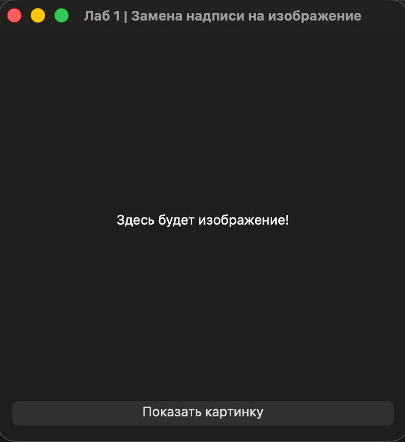

## Лабораторная работа № 1
## Волков Александр
## Группа 6233-010402D

### Задание

Окно с надписью и кнопкой. По нажатию на кнопку текст надписи заменяется картинкой.

### Архитектура и принцип работы

Приложение — это окно (класс `ImageApp`, наследник `QWidget`) с двумя элементами, расположенными друг под другом (`QVBoxLayout`):

- `QLabel` — надпись; сначала в ней текст, затем картинка;
- `QPushButton` — кнопка «Показать картинку».

**Логика работы:**

1. При запуске строится интерфейс, в надписи выводится текст «Здесь будет изображение!».
2. Кнопка связывается с обработчиком (**слотом**) через механизм сигналов и слотов: `clicked.connect(...)`.
3. При нажатии кнопка испускает сигнал `clicked`, и вызывается обработчик.
4. Обработчик загружает картинку `nature.jpeg` в `QPixmap` и проверяет результат методом `isNull()`:
    - если картинка не загрузилась (файла нет или он повреждён), в надписи показывается сообщение об ошибке;
    - иначе картинка масштабируется до 300×300 с сохранением пропорций (`KeepAspectRatio`) и сглаживанием (`SmoothTransformation`) и ставится в тот же `QLabel` через `setPixmap`, заменяя текст.

**Особенности реализации:**

- Путь к картинке строится от расположения самого файла (`Path(__file__).parent`), поэтому программу можно запускать из любой папки.
- Размер картинки вынесен в константу `IMAGE_SIZE`.

### Результат работы программы

Первый запуск:

После нажатия на кнопку "Показать картинку":

