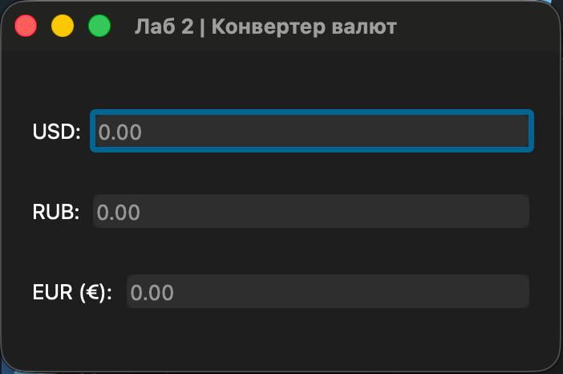
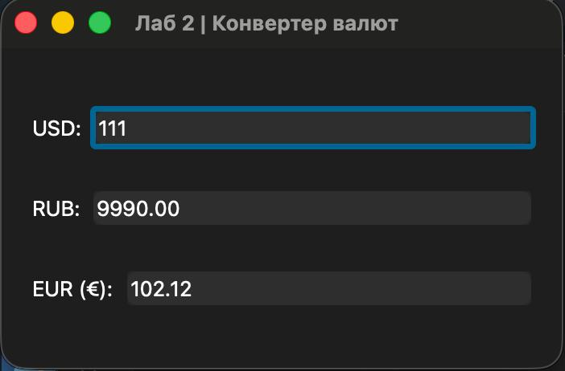
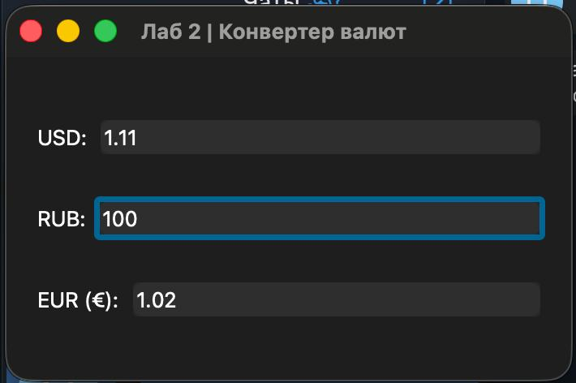
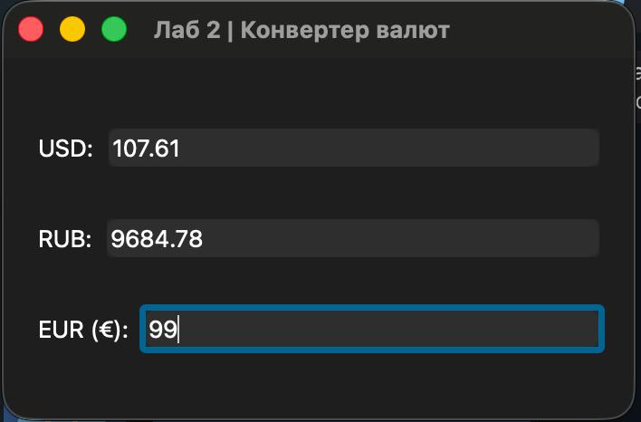

## Лабораторная работа № 2
## Волков Александр
## Группа 6233-010402D

### Задание

Конвертер валют с тремя полями ввода (USD, RUB, EUR): при изменении любого из них два других пересчитываются автоматически.

### Архитектура и принцип работы

Окно (класс `CurrencyConverter`, наследник `QWidget`) содержит три строки «подпись + поле ввода (`QLineEdit`)». Все строки создаются одним циклом по словарю `RATES`.

**Курсы валют** хранятся в словаре `RATES` — сколько единиц валюты равно 1 USD:

| Валюта | Значение |
|---|---|
| USD | 1.0 |
| RUB | 90.0 |
| EUR | 0.92 |

Чтобы добавить новую валюту, достаточно дописать по одной строке в `RATES` и `LABELS` (подписи полей).

**Логика работы:**

1. **Проверка ввода.** Ко всем полям подключён один `QDoubleValidator`: разрешены положительные числа до 10 000 000 с двумя знаками после точки.
2. **Общий обработчик.** Сигнал `textChanged` каждого поля подключён к одному методу `on_changed(source, text)`. Код изменённой валюты `source` передаётся через `functools.partial`.
3. **Пересчёт через USD.** Введённое значение переводится в доллары (`значение / RATES[source]`), затем умножается на курс каждой из остальных валют. Результат округляется до двух знаков.
4. **Защита от зацикливания (`blockSignals`).** Программная запись `setText()` в соседнее поле сама вызвала бы его `textChanged`, а тот — пересчёт обратно, и так бесконечно. Поэтому перед записью сигналы поля отключаются (`blockSignals(True)`), а после записи включаются обратно (`blockSignals(False)`).
5. **Пустое поле.** Если поле очистили, остальные поля тоже очищаются (метод `clear_other_fields`).
6. **Запятая вместо точки.** Метод `parse_value` заменяет `,` на `.`, а при некорректном тексте возвращает `0.0`.

**Особенности реализации:**

- Валидатор создаётся с `parent=self`, иначе сборщик мусора мог бы его удалить, и проверка ввода перестала бы работать.
- Один обработчик вместо трёх одинаковых — код не дублируется.

### Результат работы программы

Первый запуск:

После ввода в поле `USD`:

После ввода в поле `RUB`:

После ввода в поле `EUR`:

