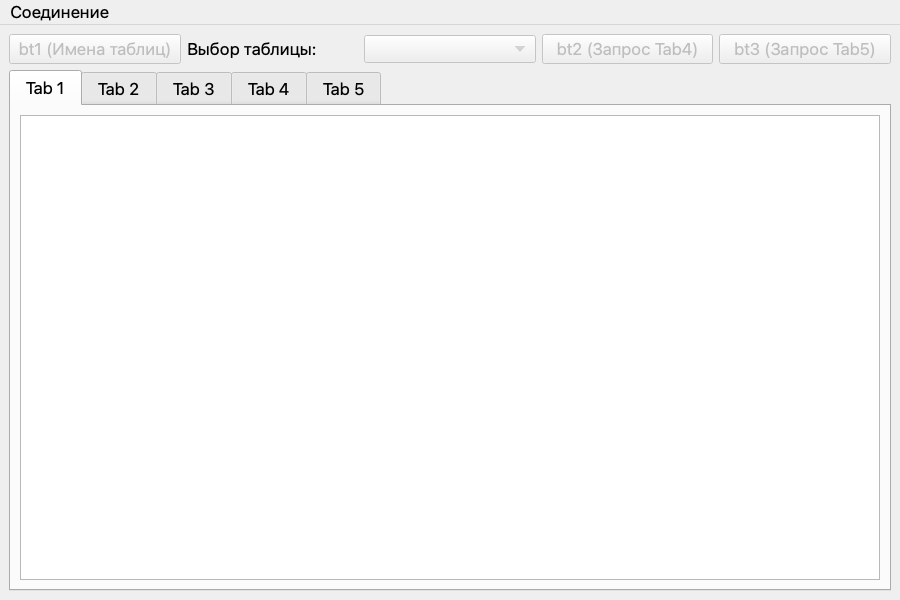
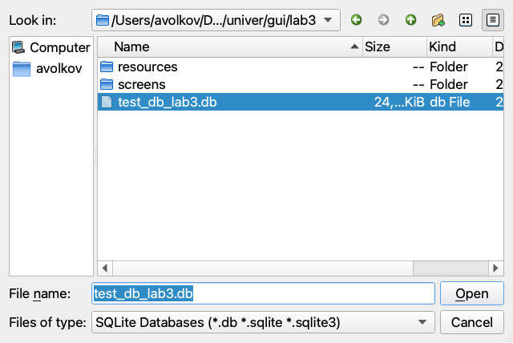
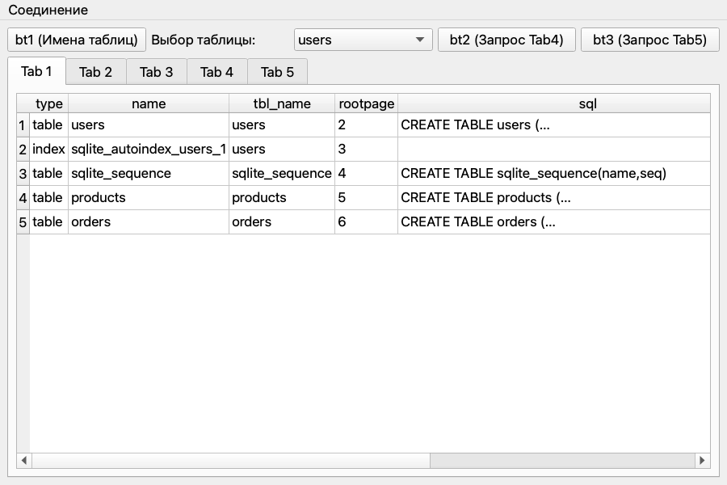
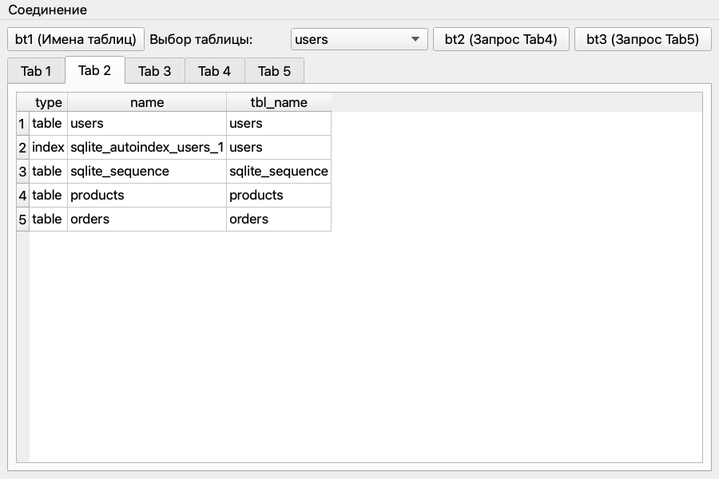
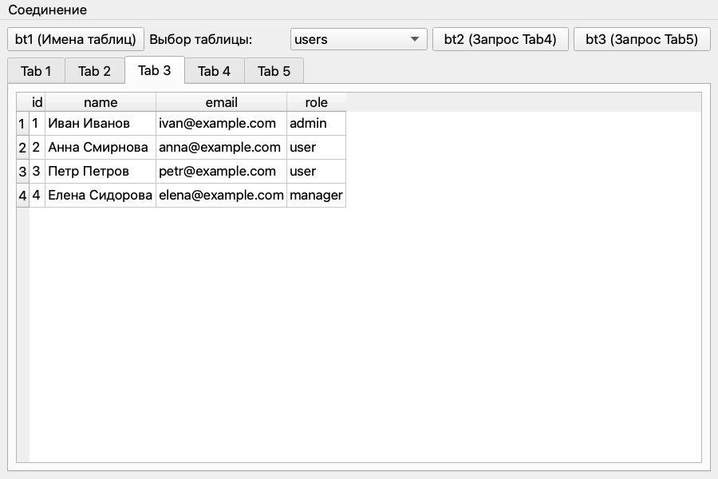
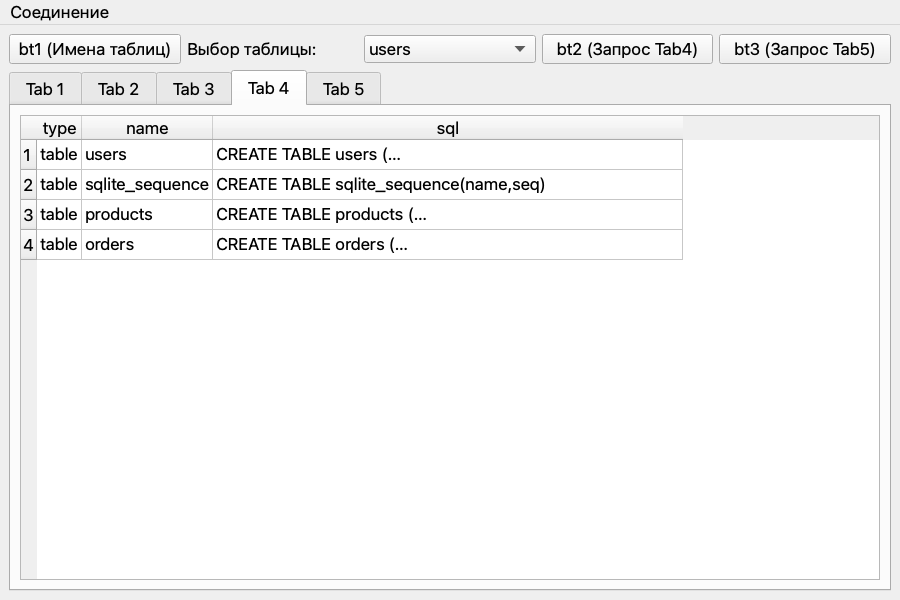
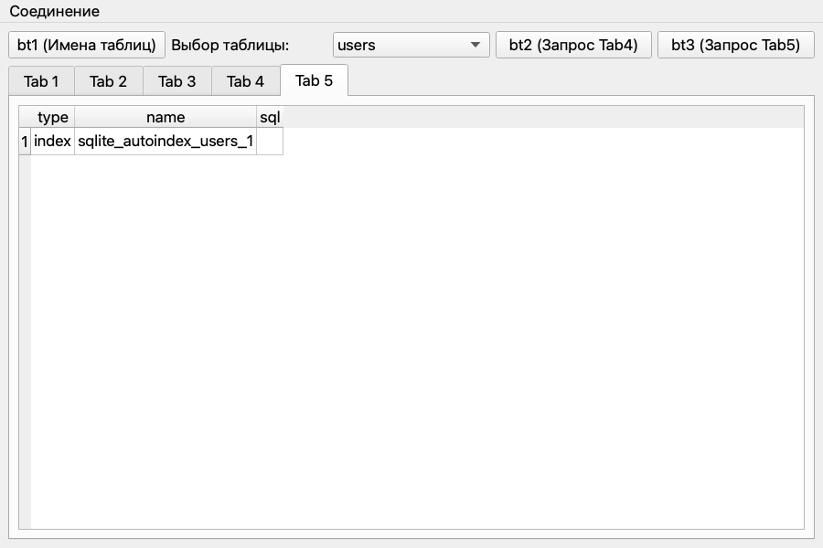
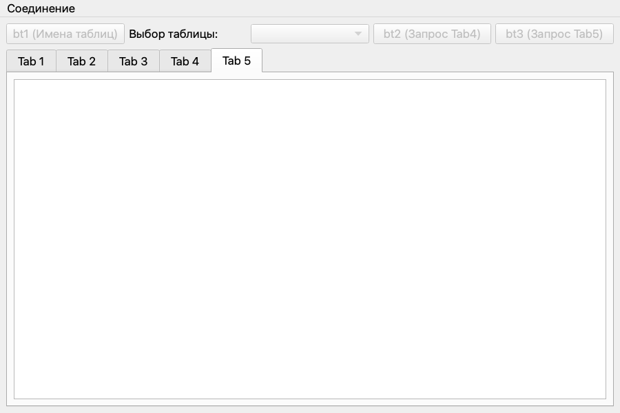

## Лабораторная работа № 3
## Волков Александр
## Группа 6233-010402D

### Задание

Окно для просмотра содержимого SQLite-базы: подключение к файлу `.db` через меню, пять вкладок с таблицами и кнопки с SQL-запросами.

### Структура

| Файл | Назначение |
|---|---|
| `db_helper.py` | Класс `Dbhelper`: создаёт тестовую БД `test_db_lab3.db` (таблицы `users`, `products`, `orders` + тестовые данные). Схема лежит в константе `SCHEMA`, данные — в `TEST_DATA` |
| `db_window.py` | Класс `DbWindow` (`QMainWindow`) — окно приложения |
| `test_db_lab3.db` | Тестовая база; пересоздаётся при каждом запуске лабораторной через `LabRunner.start_3_lab()` |
| `resources/` | Задание |

### Архитектура и принцип работы

Приложение — графический интерфейс для визуализации данных SQLite.

Используемые классы Qt:

- `QSqlDatabase` — установка, поддержание и закрытие соединения с файлом БД.
- `QSqlQueryModel` — выполняет SQL-запрос и хранит результат.
- `QTableView` — показывает модель в виде таблицы (по одному на каждую вкладку).

**Логика работы:**

1. При вызове *Set connection* пользователь через `QFileDialog` выбирает файл `.db`.
2. Приложение открывает соединение, запрашивает список таблиц из служебной таблицы *sqlite_master* и заполняет им `QComboBox`.
3. Результаты запросов выводятся во вкладки `QTabWidget`:

| Вкладка | Чем заполняется | SQL |
|---|---|---|
| Tab 1 | автоматически при подключении | `SELECT * FROM sqlite_master` |
| Tab 2 | кнопка `bt1` | `SELECT type, name, tbl_name FROM sqlite_master` |
| Tab 3 | выбор таблицы в `QComboBox` | `SELECT * FROM "<таблица>"` |
| Tab 4 | кнопка `bt2` | `... FROM sqlite_master WHERE type='table'` |
| Tab 5 | кнопка `bt3` | `... WHERE type IN ('index', 'trigger', 'view')` |

4. При вызове *Close connection* модели всех вкладок обнуляются, а соединение с БД закрывается. До подключения кнопки и список таблиц заблокированы.

**Особенности реализации:**

- Запросы, номера вкладок и путь к БД вынесены в константы (`QUERY_*`, `TAB_*`, `DB_PATH`).
- Обработчики кнопок `bt1`–`bt3` — один метод `show_query_in_tab(запрос, вкладка)`, который через `functools.partial` получает свои параметры.
- Создание тестовой БД вынесено из окна в `LabRunner`, поэтому `DbWindow` не удаляет файлы при создании.
- Путь к БД строится от расположения файла и не зависит от папки запуска.

**Результат работы программы:**

Запуск программы

Выбор файла базы данных (*Set connection*)

В случае успеха появляется `MessageBox` с уведомлением
об успешном соединении, иначе выдаст ошибку

`Tab1`: Автоматически заполняется при вызове `set_connection()` запросом 
`SELECT * FROM sqlite_master.`

`Tab2`: кнопка btn1 отправляет запрос 
`SELECT type, name, tbl_name FROM sqlite_master.`

`Tab3`: При выборе любой таблицы в `QComboBox` отправляется запрос `SELECT * FROM "<выбранная_таблица>".`

`Tab4`: Кнопка `btn2` выводит структуру таблиц `WHERE type='table'.`

`Tab5`: Кнопка `bt3` выводит индексы и представления `WHERE type IN ('index', 'trigger', 'view').`

Закрываем соединение (*Close connection*): уведомление и очищенный интерфейс

