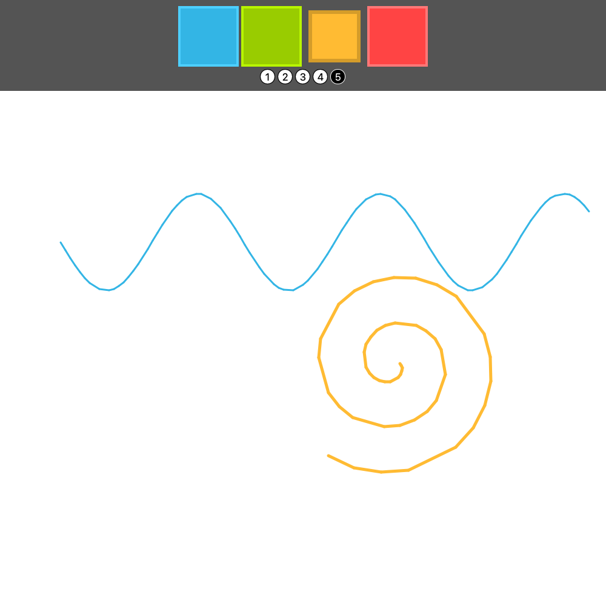
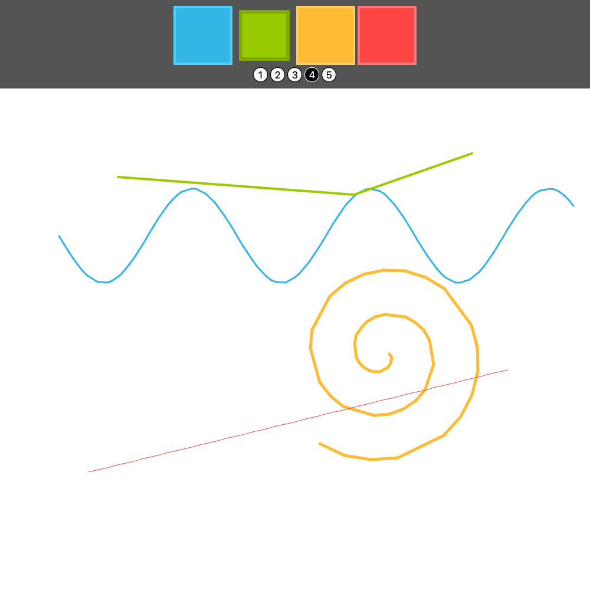
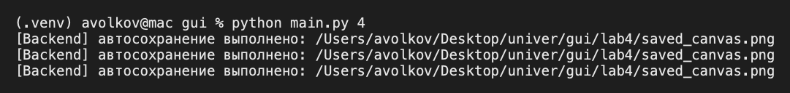

## Лабораторная работа № 4
## Волков Александр
## Группа 6233-010402D


### Задание

Простой графический редактор на QML (выбор цвета и толщины кисти, рисование мышью) с фоновым автосохранением холста из Python каждые 5 секунд.

### Структура

| Файл | Назначение |
|---|---|
| `interface.py` | Класс `Interface` (`QObject`): таймер автосохранения и вызов сохранения холста. Константы `QML_PATH`, `SAVE_PATH`, `AUTOSAVE_INTERVAL_MS` |
| `resources/template/mainWindow.qml` | Главное окно: панель инструментов и `Canvas` |
| `resources/template/Square.qml` | Кнопка выбора цвета |
| `resources/template/Circle.qml` | Кнопка выбора толщины |
| `resources/template/main.py` | Исходный шаблон из задания (в проекте не используется) |
| `saved_canvas.png` | Результат автосохранения (перезаписывается каждые 5 секунд) |

Запуск приложения (создание `QApplication`, `QQmlApplicationEngine` и загрузка QML) выполняет `LabRunner.start_4_lab()`.

### Архитектура и принцип работы

`Frontend`: графический интерфейс — выбор цвета и толщины кисти (`Square.qml`, `Circle.qml`) и область рисования (`Canvas` в `mainWindow.qml`).

`Backend`: класс `Interface` — запускает таймер `QTimer` и инициирует сохранение `Canvas` на диск.

Для связи компонентов используется контекстное свойство *rootContext().setContextProperty()*:

```python
interface = Interface(engine)
engine.rootContext().setContextProperty("_backend", interface)
```

Чтобы из Python вызвать метод сохранения, находящийся в QML-компоненте:

1. В QML элементу `Canvas` задается логическое имя `objectName: "canvas"`.

2. В Python с помощью *root.findChild(QObject, "canvas")* находится ссылка на данный элемент.

3. Через *QMetaObject.invokeMethod(...)* выполняется вызов JS-функции saveCanvas(filePath):

```python
QMetaObject.invokeMethod(
    canvas, 
    "saveCanvas", 
    Q_ARG(QVariant, str(SAVE_PATH))
)
```

## Логика работы `Canvas`:

- Обработка пользовательского ввода происходит через *MouseArea*. При перемещении курсора фиксируются координаты mouseX и mouseY, после чего вызывается *canvas.requestPaint().*

- В обработчике *onPaint* с помощью 2D-контекста `(getContext("2d")) `вычерчиваются сглаженные линии заданной толщины и цвета.

## Фоновое сохранение по `QTimer`:

В классе `Interface` инициализирован объект `QTimer`:

```python
self.timer = QTimer(self)
self.timer.setInterval(AUTOSAVE_INTERVAL_MS)  # 5000 мс = 5 секунд
self.timer.timeout.connect(self.autosave)
self.timer.start()
```

*Принцип работы*: Каждые 5000 мс (5 секунд) срабатывает сигнал timeout, вызывающий слот *autosave().*

*Результат*: Слот берёт путь `SAVE_PATH` (файл *saved_canvas.png* рядом с `interface.py`) и отправляет сигнал холсту QML пересохранить текущий рисунок на диск без остановки работы пользователя.

**Особенности реализации:**

- Пути к QML и к файлу сохранения строятся от расположения `interface.py`, поэтому программа не зависит от папки запуска.
- В `mainWindow.qml` флаг `isInitialized` объявлен как свойство `Canvas`, а не неявная глобальная переменная.
- Переменные окружения Qt задаются один раз в `qt_setup.py` до создания приложения.

**Результат работы программы**





Лог в консоли при запуске `python main.py 4` — автосохранение срабатывает каждые 5 секунд:

